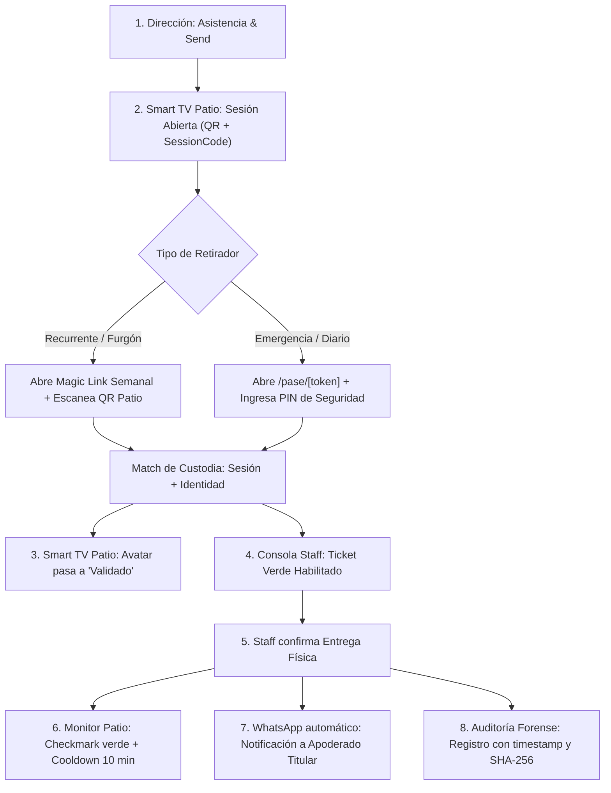

# PRD — PickMe: Gestión de Salida Escolar con Cadena de Custodia Digital

**Versión:** 2.5  
**Estado:** En desarrollo y estabilización de QA  
**Documento técnico relacionado:** [SDD.md](SDD.md)

---

## 1. Problema y Oportunidad

El proceso de retiro escolar es uno de los momentos de mayor riesgo, congestión y fricción en la operación diaria de un colegio. Los métodos tradicionales —listas en papel, megáfonos, llamadas verbales de nombres y registros manuales en portería— generan:

- **Riesgo crítico de seguridad y custodia:** alumnos entregados a personas no autorizadas, transportistas que cambian de chofer sin aviso formal o terceros sin validación previa del apoderado titular.
- **Vulneración de privacidad:** gritar nombres y apellidos de menores en la vía pública expone su identidad e itinerario a extraños.
- **Cuellos de botella en el portón:** congestión vehicular y peatonal durante el peak de salida (15–20 minutos críticos).
- **Falta de trazabilidad auditable:** ausencia de un registro inmutable con firma forense de quién retiró a qué menor, con qué autorización, a qué hora exacta y bajo la custodia de qué funcionario del colegio.
- **Fricción innecesaria:** apoderados y transportistas obligados a descargar aplicaciones móviles pesadas que casi nadie instala o mantiene actualizadas.

**La Oportunidad:** Digitalizar la salida escolar mediante una **cadena de custodia física y digital**, combinando la proyección lúdica anónima en Smart TV (Capa 0) con enlaces seguros web (PWA ligera), canales de WhatsApp y autenticación institucional estricta.

---

## 2. Principios y Restricciones No Negociables

| Restricción | Razón Técnica y de Negocio |
|---|---|
| **Cero Apps Nativas (iOS/Android)** | Adopción inmediata sin fricción; URLs seguras con TLS 1.3 y PWA web responsiva. |
| **0% Mocks en Flujo Productivo** | Base de datos PostgreSQL (Neon) real, multi-tenant estricto con `schoolId` en toda entidad. (El simulador comercial `/simulador` es un sandbox aislado en memoria). |
| **Google Workspace OAuth Real** | Acceso institucional directo para equipos directivos y staff, con auto-provisioning de cuentas en base de datos. |
| **CSS Modules Exclusivo** | Cero dependencias externas de estilos (cero Tailwind), control milimétrico del bundle y diseño institucional Cosmic Dark / High Contrast. |
| **Privacidad por Capas (Avatares Anónimos)** | Ningún nombre completo de alumno se proyecta en pantallas públicas. Cada alumno posee un avatar único (Animal + Color) asignado sin colisiones por sala. |
| **Verificación Cruzada de Custodia** | Staff en portón no entrega ningún alumno sin ticket verde de validación entre la identidad del retirador y la sesión activa del día. |

---

## 3. Matriz de Roles y Privilegios

| Rol | Alcance / Vistas | Privilegios y Responsabilidades |
|---|---|---|
| **SUPERADMIN** | `/admin/*`, Soporte global | Gobernanza multi-colegio, métricas globales de plataforma, auditoría a nivel sistema. |
| **SCHOOL_ADMIN** (Director / Equipo Directivo) | `/admin`, `/admin/cursos`, `/admin/staff`, `/admin/auditoria`, `/admin/onboarding` | 1. Configuración institucional y zona horaria. 2. Creación de cursos, carga de nóminas y asignación de avatares. 3. Toma de asistencia y apertura de jornada ("Send"). 4. Emisión y revocación de pases diarios de emergencia. 5. Gestión e invitación de personal de portería (`STAFF`). 6. Descarga de logs forenses con firma SHA-256. 7. **Bypass de Entrega Asistida**: Cierre de custodia manual asumiendo responsabilidad institucional si el staff no está en funciones. |
| **STAFF** (Portero / Inspector de Puerta) | `/staff`, `/staff/join` | 1. Consola de portón con escáner QR de pases. 2. Verificación de ticket verde (foto, nombre, autorización, avatar del alumno). 3. Confirmación física de entrega ("Entregar Alumno"). 4. Disparo del trigger de notificación WhatsApp al apoderado titular. |
| **PICKER RECURRENTE** (Transportista Escolar / Tío del Furgón / Familiar habitual) | `/retirar`, WhatsApp | 1. Enlace/token de validación semanal seguro enviado a su WhatsApp. 2. Retiro por lote de los alumnos asignados a su furgón. 3. Escaneo o match con el QR/SessionCode del monitor de patio para activar su ticket en portería. |
| **PICKER DE EMERGENCIA** (Retiro imprevisto / Reemplazo diario) | `/pase/[token]` | 1. Enlace temporal exclusivo para la jornada. 2. Validación obligatoria mediante **PIN de seguridad** (2, 3 o 6 dígitos configurado por Dirección). 3. Presentación de pase en portón para escaneo del personal. |
| **APODERADO TITULAR** | WhatsApp, `/retirar` | 1. Autorización de retiradores habituales o diarios. 2. Recepción de confirmación instantánea por WhatsApp cuando su pupilo ha sido entregado en portón. |

---

## 4. Cadena de Custodia y Ciclo de Vida del Retiro

### Microestados del Monitor de Patio (Smart TV Board - Capa 0)
1. **En Colegio (`WAITING`):** El alumno está en el recinto esperando que alguien inicie su retiro.
2. **Picker en Camino (`IN_PROCESS`):** El transportista o apoderado anunció su llegada o proximidad.
3. **Picker Validado (`VALIDATED`):** El retirador hizo match entre su identidad/pase y la sesión activa del patio. Señal visual para que el alumno se acerque a portería.
4. **Alumno Entregado (`HANDOVER` / `IN_TRANSIT`):** El funcionario de portón confirmó la entrega física.
   - **Cooldown de 10 minutos:** El avatar muestra un checkmark verde y permanece visible durante exactamente 10 minutos antes de desaparecer de la pantalla.
5. **Bypass Administrativo (`BYPASS_DELIVERED`):** Si un alumno queda rezagado o el turno del portero terminó, la Dirección asume la entrega desde el panel central con registro explícito de responsabilidad.

---

## 5. Requerimientos Funcionales por Módulo

### M1: Onboarding y Autenticación
- Acceso principal mediante **Google Workspace OAuth** institucional.
- Si el usuario de Google no existe en la base de datos, se auto-provisiona como `SCHOOL_ADMIN` y se le conduce a `/admin/onboarding`.
- Opción secundaria de **Credenciales Institucionales** (correo y contraseña).
- En `/admin/onboarding`, el director ingresa nombre del colegio, dirección, teléfono de emergencia, zona horaria y largo de PIN de pases (2, 3 o 6 dígitos).

### M2: Gestión de Nómina y Cursos
- Creación de salas (`Classroom`: Grado y Sección).
- Carga de alumnos manual o masiva CSV con normalización automática de datos.
- Asignación determinista de avatares anónimos (200 combinaciones únicas sin colisión por sala).
- Botón **"Send / Sincronizar"**: Apertura explícita de jornada y sincronización de lista viva. Si un alumno ausente llega tarde, `addLateArrivalToSessionAction` lo incorpora a la sesión activa sin reiniciar el tablero.

### M3: Smart TV Board (Capa 0)
- Acceso público `/board` o con `sessionCode`.
- Renderizado de avatares con colores de alto contraste y animaciones sutiles.
- Despliegue permanente del QR de sesión del patio y el código alfanumérico del día.
- Temporizador / cooldown de 10 minutos para alumnos entregados.

### M4: Consola de Portón (`/staff`)
- Acceso restringido a personal con rol `STAFF` activo y asignado a la escuela.
- Enrolamiento de porteros vía token de invitación `/staff/join?token=...`.
- Cola de entregas en tiempo real.
- Ticket verde con verificación de identidad, fotografía, transportista asociado y botón de confirmación de entrega.
- Enlace directo con payload preformateado a WhatsApp para notificar al apoderado titular.

### M5: Pases de Emergencia y Furgones Escolares
- Emisión de pases diarios `/pase/[token]`.
- Desafío de PIN según política escolar (2 dígitos básico, 3 dígitos intermedio, 6 dígitos alta seguridad).
- Opción en `/admin` para revocar pases en caso de anulación o cambio de plan del apoderado.
- Dashboard de transportes escolares con lista de furgones y alumnos asignados.
